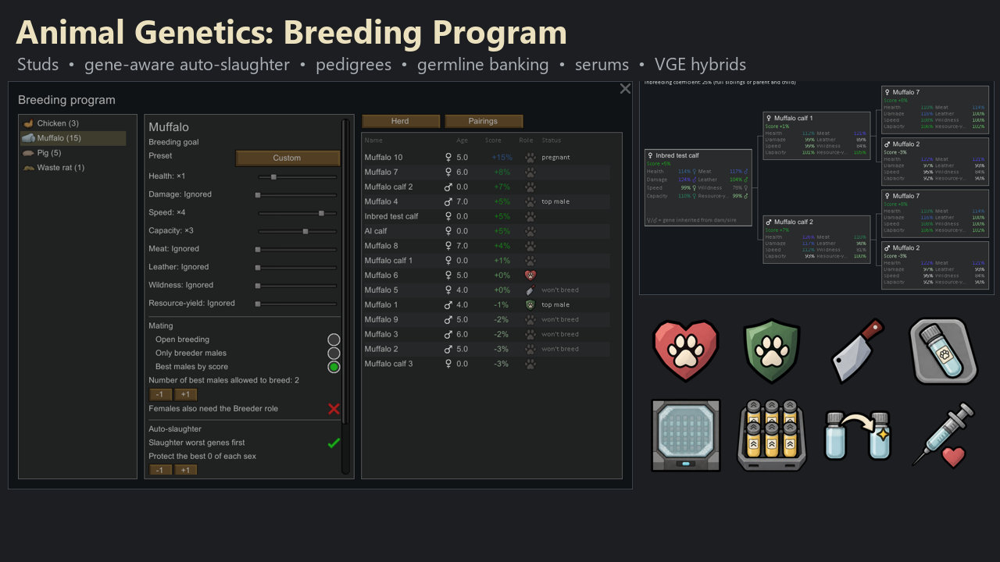
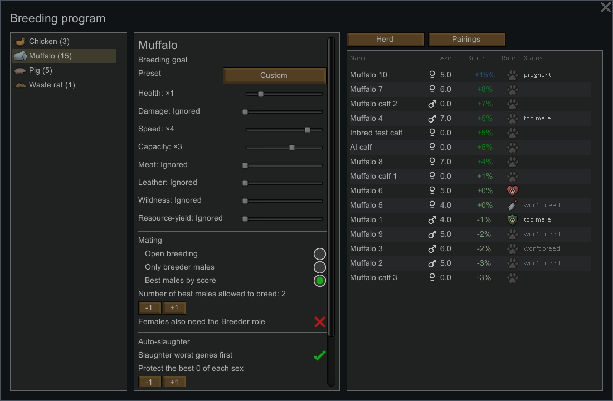
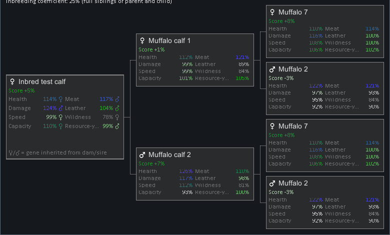
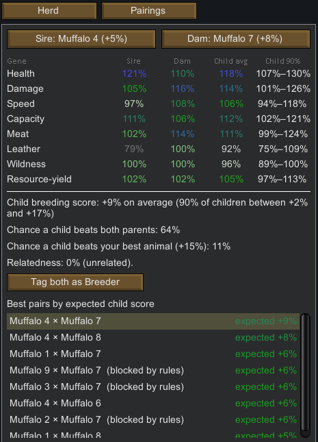
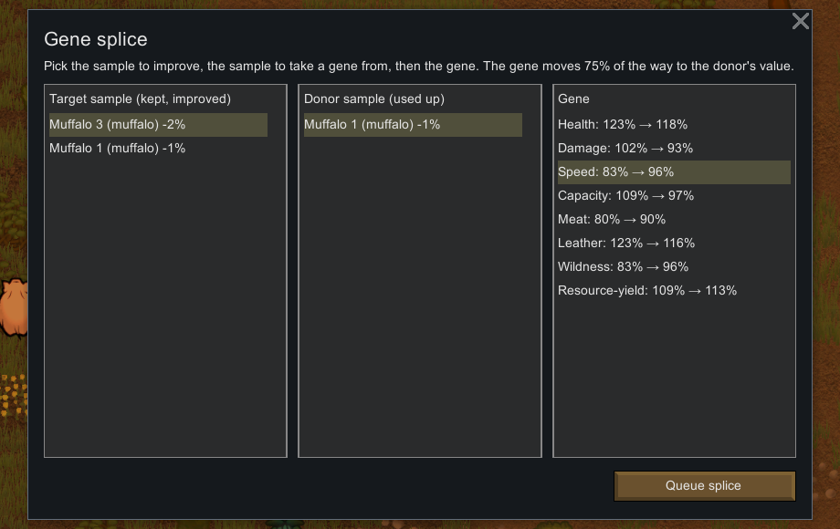
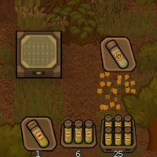

# Animal Genetics: Breeding Program

A RimWorld 1.6 add-on for **[Animal Genetics (Continued)](https://steamcommunity.com/sharedfiles/filedetails/?id=2830943477)** that gives you a real breeding program: choose who breeds, protect your best bloodlines, cull the worst, bank genes, and tune the next generation.

Animal Genetics gives every animal inheritable genes (health, damage, speed, carrying capacity, meat, leather, wildness, milk/wool/eggs), but leaves the breeding itself to chance. Any male mates with any female, and auto-slaughter can kill your best stud. This mod adds the controls, the information and the lab tech to breed on purpose. It doesn't replace Animal Genetics' gene model; it builds on it, and it optionally extends [Vanilla Genetics Expanded](https://steamcommunity.com/sharedfiles/filedetails/?id=2801160906).



## Features

### Herd management (available from the start)
- **Breeding goals per species.** Pick a preset (pack animal, meat & leather, milk/wool/eggs, war beast, docile, balanced) or set your own weight for each gene. Every animal then gets one **Breeding Score**.
- **Herd roles:** *Breeder*, *Keep* and *Cull*. Set them from the animal's button, the Animals tab, the Genetics tab, or the Breeding Program window.
- **Mating control per species:**
  - open breeding;
  - breeder males only;
  - the best N males by score (the ranking updates by itself).

  Cull animals never breed. You can also require females to be Breeders.
- **Gene-aware auto-slaughter.** Vanilla still decides *how many* animals go; this mod decides *which*. Breeders and Keeps are never taken, and the worst genes go first. Options:
  - protect the best N of each sex;
  - always slaughter Culls;
  - cull adults below a score.



### Breeding insight
- **Pedigree tab.** Shows three generations with each ancestor's genes, which parent each gene came from, and the inbreeding coefficient. Ancestors that died long ago still show up.
- **Pairings view.** For any sire and dam it predicts each gene and the child's score, the chance a child beats both parents or your best animal, and how related the pair is. It also ranks the best pairs in your herd.
- **Optional inbreeding depression** (mod settings, off by default). Related parents produce weaker children.

| Pedigree | Pairings |
|---|---|
|  |  |

### Germline banking (research: *germline banking*, needs Electricity)
- **Collect a germline sample** from a male, either with the button on the animal or through a Health-tab operation. The sample keeps that exact male's genes, so his line survives after he is sold or dead.
- **Cryobank:** a 1×1 powered cabinet. Samples inside never spoil. On the floor they last 3 days unless frozen.
- **Insemination.** Use the *Inseminate…* button to pick an exact sample (each option shows the expected child score and relatedness), or the Health-tab operation, which uses the best matching sample. Works for egg-layers too: the hen lays eggs fathered by the sample.
- **Egg sorting.** Stockpile filters for *good genes* and *poor genes* fertilized eggs.

### Germline tuning (research: *germline tuning*)
- **Serums**, made at the drug lab:
  - *Dominance:* one chosen gene always comes from the better parent.
  - *Stabilizing:* children mutate 0.25× as much.
  - *Mutagenic:* children mutate 3× as much, a gamble in both directions.

  Give them with the *Apply serum…* button or a Health-tab operation.
- **Gene splice** at the cryobank: move one gene from a donor sample into a target sample (75% of the way). The donor sample is used up.

| Gene splice | Serums & cryobank |
|---|---|
|  |  |

### Vanilla Genetics Expanded integration (automatic when VGE is loaded)
- **Genomes remember their source.** A genome from the extractor table or an excavator records the animal it came from, e.g. "muffalo genome (from Muffalo 9)", and genomes from different animals don't stack.
- **Hybrids inherit real genes.** The two source animals' genes are carried through the genomorpher, growth cell and electrowomb, so the hybrid inherits them instead of rolling random ones. Hybrids also show up in pedigrees.
- **Research** moves to VGE's genetics tab, after *Genetic Alteration*. Serums can also be made at the genetics tinkering table.
- **Trading:** the VGE genetics trader buys and sells germline samples ("pedigree stock") and serums. Samples are priced by their genes.

### Performance fix for big herds and modlists
The Animal Genetics *Genetics* tab, and the vanilla *Wildlife* and *Animals* tabs, could slow the whole game with a few hundred animals. This mod fixes three causes:
- the Genetics tab rebuilt itself on every GUI event;
- every open animal table rebuilt whenever any pawn spawned or despawned;
- tables drew row lines for every off-screen row.

Measured with ~360 animals, drawing is about 3× faster and the constant rebuilds are gone. Works with **Numbers** and **Animal Tab (Continued)**.

## Requirements
- RimWorld 1.6
- [Harmony](https://steamcommunity.com/sharedfiles/filedetails/?id=2009463077)
- [Animal Genetics (Continued)](https://steamcommunity.com/sharedfiles/filedetails/?id=2830943477)
- Optional: [Vanilla Genetics Expanded](https://steamcommunity.com/sharedfiles/filedetails/?id=2801160906)

Load order: Harmony → Animal Genetics → (VGE) → this mod. Safe to add to an existing save.

## Compatibility (tested in game)

| Mod | Result |
|---|---|
| Vanilla Genetics Expanded (+ Vanilla Expanded Framework) | Integrated; full genome → hybrid chain tested |
| RimHUD, Dubs Mint Menus, Scrollable Inspect Panes | Full test suite and UI smoke test (every window, tab, menu and inspect pane the mod adds) pass with zero errors |
| Numbers | Same, and its replacement Wildlife/Animals windows get the performance fix |
| Animal Tab (Continued) | Same; it uses the vanilla Animals table, so the Score and Role columns appear there |
| Colony Manager | Not integrated: Animal Genetics' own Colony Manager option still works, but it doesn't know about herd roles |
| Multiplayer | Not supported |

## Getting started
1. Open the **Genetics** tab and click **Breeding program**. Pick a species and a breeding goal.
2. Choose a mating rule. *Best males by score* is a good default.
3. Leave *Slaughter worst genes first* on, and set your usual auto-slaughter limits.
4. Tag the animals you never want to lose as **Keep** or **Breeder**.
5. Later, research **germline banking**, build a **cryobank**, and start collecting samples from your best males.

Note: Health-tab operations follow vanilla rules, so the animal must be lying in an animal bed or sleeping spot before a doctor will start. The buttons on the animal don't have that requirement.

## Known limitations
- The Pairings preview and the Inseminate menu don't yet account for an active serum when predicting children.
- Genomes duplicated with VGE's genome recombinator don't keep their source animal.
- Removing the mod mid-save drops its items (samples, serums, cryobank) and their data.

## Building from source
The C# project is in `Source/AnimalGeneticsBreeding` and targets .NET Framework 4.8. It references the game's managed DLLs, Harmony and Animal Genetics from a RimWorld install. Set your paths with `RimWorldDir` (it defaults to the author's install):

```bash
dotnet build Source/AnimalGeneticsBreeding/AnimalGeneticsBreeding.csproj -c Release -p:RimWorldDir="C:/Path/To/RimWorld"
```

The build output goes to `1.6/Assemblies/`. `deploy.sh` builds the mod and copies it into a local Mods folder; edit its paths for your setup.

## Testing
`Tests/` contains an in-game integration harness: a separate test-only mod. `Tests/run-ingame-tests.sh` starts RimWorld with an **isolated save-data folder** and a minimal mod list, then uses `-quicktest` to jump straight into a map. The harness then:
- runs about 160 checks: herd rules; natural mating over time; colonists actually slaughtering; real handler and doctor jobs; inheritance statistics checked against Animal Genetics' own generator; save/reload;
- opens every window the mod adds while watching the log for any error coming from the mod;
- takes screenshots, then quits.

Options: `--vge` (loads VEF + VGE), `--ui` (loads RimHUD, Dubs Mint Menus, Numbers, Animal Tab, Scrollable Inspect Panes), `--perf` (pawn-table benchmark). A run takes 40–130 s and never touches your normal config or saves.

A write-up of the toolchain, patterns and harness used to build this mod, in the form of an agent skill for AI coding tools, is in [](.claude/skills/rimworld-modding/SKILL.md).

## Credits
- **Animal Genetics** by gregorycurrie & Ryan Briscoe, continued by Mlie. This mod depends on it and builds on its gene model.
- **Vanilla Genetics Expanded** by the Vanilla Expanded team (Oskar Potocki, Sarg Bjornson and others), used for the optional integration and as the art-style reference.
- Art was generated for this mod using Vanilla Genetics Expanded and the mod's own textures as style references.

## License
[MIT](LICENSE)
